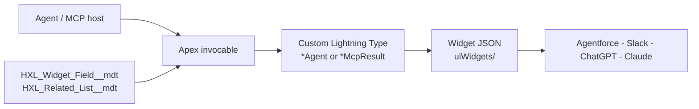

# Render Anywhere

**Build a widget once, render it in every agent.**

A Headless Experience Layer (HXL) project for Salesforce: five JSON widgets, each backed by an Apex
invocable and a Custom Lightning Type, rendered natively in Agentforce, Slack, ChatGPT, Claude, or
any MCP host.

## What it does

| Widget               | Apex invocable                   | Agentforce action              | Example prompt                              |
| -------------------- | -------------------------------- | ------------------------------ | ------------------------------------------- |
| Asset Detail         | `de_HXL_GetAssetDetail`          | `HXL_Get_Asset_Detail`         | `Asset details for serial number SN-1001`   |
| Account 360 Snapshot | `de_HXL_GetAccount360`           | `HXL_Get_Account_360`          | `Account 360 for Northwind Traders`         |
| Contact Quick View   | `de_HXL_GetContactQuickView`     | `HXL_Get_Contact_Quick_View`   | `Jane Doe Contact Quick View`               |
| Case Detail          | `de_HXL_GetCaseDetail`           | `HXL_Get_Case_Detail`          | `Case details for #00001000`                |
| Opportunity Pipeline | `de_HXL_GetOpportunityPipeline`  | `HXL_Get_Opportunity_Pipeline` | `Opportunity Pipeline for Alex Morgan`      |

Swap the example records for ones that exist in your org.

## Architecture



Apex invocable -> Custom Lightning Type (`lightningTypes/*Agent` for Agentforce, `*McpResult` for
MCP) -> widget JSON (`uiWidgets/`). The "Details" rows and related lists are driven by custom
metadata so they can be edited without code. The LWCs are admin tooling only (the **HXL MCP Setup
Guide** tab and the Widget Field Settings editor); they are not on the render path.

## Components

| Path | Purpose |
| ---- | ------- |
| `classes/de_HXL_Get*` | Five invocable actions that resolve a name/number/Id and build the widget payload |
| `classes/de_HXL_FieldConfig`, `de_HXL_Format`, `de_HXL_RelatedList*`, `de_HXL_Resolve`, `de_HXL_Search`, `de_HXL_PersonAccountView` | Shared config, formatting, related-list, lookup and person-account logic |
| `uiWidgets/` | The five widget definitions and schemas |
| `lightningTypes/` | Custom Lightning Types per widget, for Agentforce and MCP output |
| `genAiFunctions/` | Agentforce actions wrapping the invocables |
| `mcpServerDefinitions/HXLXDO` | MCP server exposing the tools and widget resources |
| `customMetadata/`, `objects/*__mdt` | Widget field and related-list configuration |
| `lwc/de_hxl*` | MCP setup guide, widget field editor, preview, field path picker |
| `permissionsets/` | `HXL_MCP_Permissions`, `HXL_Widget_Field_Editor` |

## Prerequisites

- Salesforce CLI (`sf`) and an org with Einstein generative AI / Agentforce.
- API 67.0+.
- For MCP channels: an External Client App with OAuth enabled for hosted MCP.

## 1. Deploy (one time per org)

Requires API 67.0+ and an org with Einstein generative AI / Agentforce available.

```bash
ORG=<your-org-alias>

# a. Feature settings first, on their own: UiWidgetBundle and GenAiFunction metadata
#    types don't exist in the org until these are on.
sf project deploy start -d force-app/main/default/settings -o $ORG

# b. Everything else, running this project's tests.
sf project deploy start -d force-app -o $ORG --test-level RunSpecifiedTests \
  --tests de_HXL_FieldConfigTest --tests de_HXL_FormatTest --tests de_HXL_GetAccount360Test \
  --tests de_HXL_GetAssetDetailTest --tests de_HXL_GetCaseDetailTest \
  --tests de_HXL_GetContactQuickViewTest --tests de_HXL_GetOpportunityPipelineTest \
  --tests de_HXL_PersonAccountViewTest --tests de_HXL_RelatedListTest --tests de_HXL_ResolveTest \
  --tests de_HXL_SearchTest --tests de_HXL_WidgetFieldEditorTest

# c. Permissions: every user who runs the widgets needs HXL_MCP_Permissions;
#    admins who edit widget fields also need HXL_Widget_Field_Editor.
sf org assign permset -n HXL_MCP_Permissions -n HXL_Widget_Field_Editor -o $ORG
```

Then check, in Setup:

- **Headless Experience Layer Settings** shows HXL on (accept the beta terms if prompted).
- **Custom Permissions → MCPService** exists and is enabled (pre-enabled on most Einstein orgs, not
  all). Needed only for the MCP channels.
- **Demo data**: Assets with a Product, Account, Contact, Install Date, and Usage End Date (the
  lifecycle bar only shows when Usage End Date is set).

## 2. Connect a channel

Open the **HXL MCP Setup Guide** tab in the org for the full, screenshot-by-screenshot steps with
copy buttons. Summary:

### Agentforce (Lightning): no MCP or OAuth

Agentforce Studio → Agents → open (or create) an agent, deactivate it or make a new version →
**Add from Asset Library** → search `HXL` → select the five `HXL Get …` actions → Add to Agent →
activate. Output Rendering is pre-set; if a generic card shows instead of the widget, check the
action output's Output Rendering is the matching `*Agent` type (e.g. `assetDetailAgent`).

### MCP channels (Slack, ChatGPT, Claude, other MCP hosts)

Shared prerequisites:

1. **External Client App `Headless_360_Hosted_MCP`.** Not in this repo. Create an External Client
   App with that name, OAuth enabled, and the `api`, `refresh_token` and `mcp_api` scopes. AI
   clients authenticate through it.
2. **Activate the MCP server**: Setup → MCP Servers → **HXLXDO** → Activate (no Metadata API
   equivalent).

MCP server URL: `https://api.salesforce.com/platform/mcp/v1/custom/HXLXDO` (production / Developer
Edition) or `https://api.salesforce.com/platform/mcp/v1/sandbox/custom/HXLXDO` (sandbox / scratch).

| Channel | Steps |
| ------- | ----- |
| Slack   | Workspace must already be connected to the org. Slack admin: Tools & settings → Manage Salesforce MCP → Add MCP Server → **HXLXDO** → pick workspaces and member access → Connect. Each user then toggles the connection on in Slackbot. Renders as Block Kit (lower fidelity). |
| ChatGPT | Enable Developer Mode → Plugins → Create app → server URL above, OAuth. Copy ChatGPT's generated Callback URL into the ECA's Callback URLs (new line), then paste Client ID + Secret (ECA → Consumer Key and Secret) and the org's `/services/oauth2/authorize` and `/services/oauth2/token` URLs. |
| Claude  | Settings -> Connectors -> Add custom connector: server URL above, OAuth Client ID/Secret from the ECA, and add Claude's callback URL to the ECA. |
| Other   | Same as ChatGPT: server URL + OAuth against the ECA, and register the host's callback URL in the ECA. |

## 3. Customise widget fields (optional)

The "Details" section of each widget comes from `HXL_Widget_Field__mdt` records. Edit them in the
**Widget Field Settings** editor (needs `HXL_Widget_Field_Editor`), or as files under
`customMetadata/`. Asset Detail ships with `AD_Detail_*` rows: Product Family, Competitor Product,
Parent Asset, Asset Owner. Fields that don't exist in the org or that the user can't read are
skipped.

## Configuration

- **External Client App** `Headless_360_Hosted_MCP` (MCP channels only): create it in your org; the
  Consumer Key/Secret are entered in the MCP host, never in this repo.
- **Custom metadata**: `HXL_Widget_Field__mdt` and `HXL_Related_List__mdt` records ship with
  defaults. Some rows reference custom fields from Salesforce demo orgs (names starting with
  `SDO_`, e.g. `SDO_Sales_Region__c`); in orgs without them the rows are skipped automatically.
- No credentials, Named Credentials or environment variables are required.

## Screenshots

Add screenshots to `docs/screenshots/`. (The in-org setup guide uses the images in
`staticresources/`.)

## License

MIT, see [LICENSE](LICENSE).
